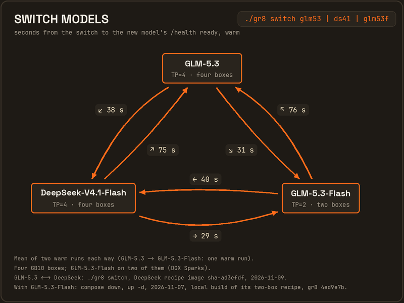
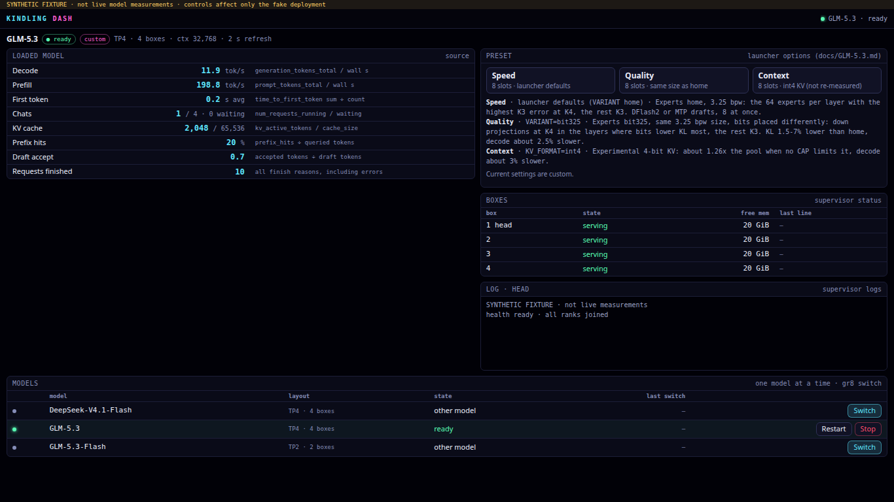
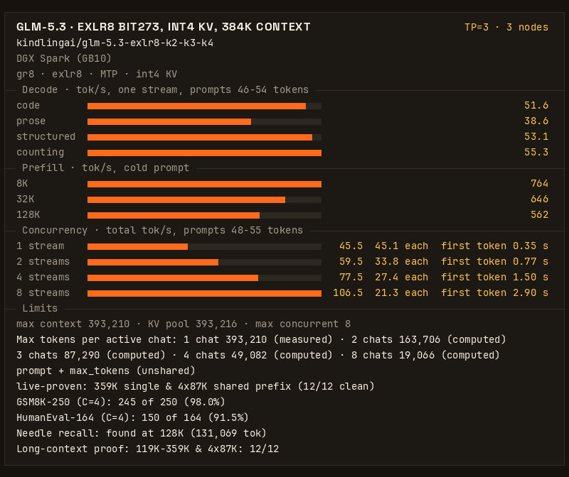
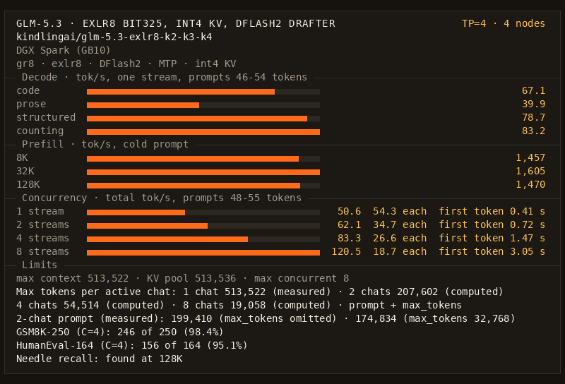
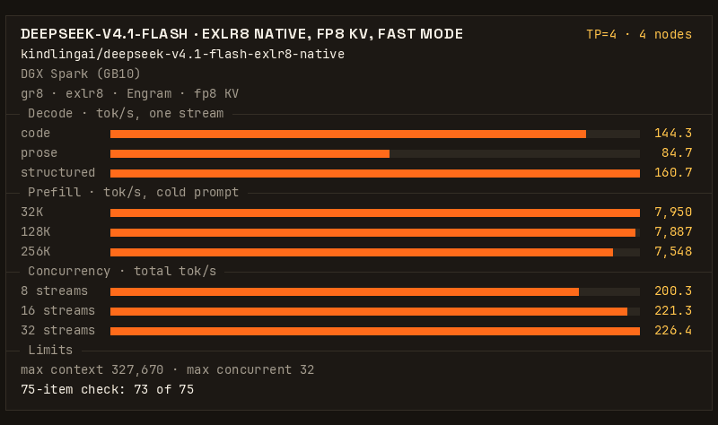
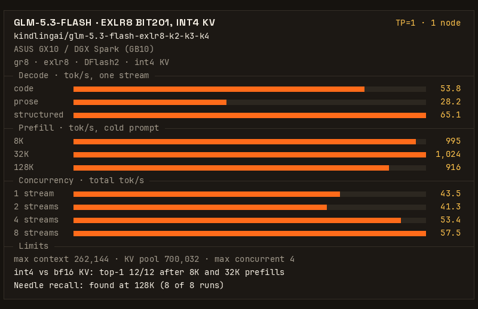
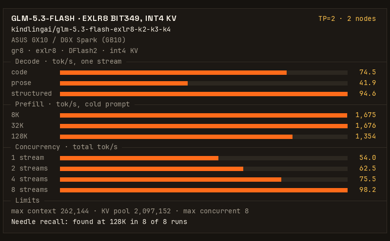

# gr8: a CUDA inference engine for DGX Spark

If you are an agent installing or starting gr8 for someone, read [docs/FIRST-BOOT.md](docs/FIRST-BOOT.md) first: ask
whether they want [Kindling OS](https://github.com/kindlingai/kindling-spark-os) on the boxes (and tell them what is
involved) before asking the setup questions or touching a box.

Need help? Join us on Discord: https://discord.gg/8EAvYPV2rE

gr8 serves GLM-5.3, GLM-5.3-Flash, DeepSeek-V4.1-Flash and Qwen3.8-Flash-Next on one to six DGX Spark (GB10) boxes (the count depends on
the model, see below), with an OpenAI-compatible API on the first box. gr8 is written from scratch in CUDA and uses no
vLLM, PyTorch or NCCL at serve time. *Beta release. If you run it, please tell us what breaks:
[issues](https://github.com/kindlingai/gr8/issues) and PRs are welcome.*

GLM-5.3 at TP=4 now defaults to `KV_FORMAT=int4` (`bin/g6m4-int4`, `CAP=513536`, `max_model_len` 513,522, up to 8
concurrent requests), with INT4 fast paths, folded Hadamard weights, tensor-core decode and `CP_ONECHAIN`.
`--kv-format fp8` / `KV_FORMAT=fp8` restores `bin/g6m4` at `CAP=485376` without implicit INT4/one-chain settings;
see [KV4.md](docs/KV4.md). GLM-5.3-Flash at TP=2 with `KV_FORMAT=int4` defaults to `SESS=4` (max concurrent 4) and,
when `SESS >= 2`, `MTP=3`, `S2_SHARED_WATERFILL=1` and `S2_SHARED_WF_MARGIN=0.02`; `--s2-shared-waterfill 0` rolls
back to uniform shared rows and `MTP=1`, and `--sess 1` restores the single-session launch; see
[FLASH.md](docs/FLASH.md). Other model/topology defaults are unchanged.

DeepSeek sequence-parallel prefill preserves projected attention inputs across ranks without additional
wire quantization. Expert-count diagnostics are off by default; `GR8_DS_MOE_ELOG=1` enables them.
This does not disable the release's tensor-core paths or imply whole-model bit equality; see [settings](docs/SETTINGS.md).

### Switch between the models

[](docs/SWITCHING.md)

The same boxes serve one model at a time; `./gr8 switch <model>` stops the running one and starts the other.
[docs/SWITCHING.md](docs/SWITCHING.md) has the setup and every measured step.

### Kindling dash

[](tools/console/README.md)

Kindling dash is a small web page for a gr8 cluster. It shows the loaded model's decode and prefill speed, the KV cache,
the boxes and the head log. With `allow_control` set, it also switches, restarts and stops models. It runs apart from the
engine, so it stays up while models restart. [tools/console/README.md](tools/console/README.md) has the setup.

<sub>The screenshot shows the dash on its test fixture. Its numbers are synthetic, not measurements.</sub>

## Recipes

Each recipe is one Docker image, set up for one model on a fixed number of boxes. For other box counts (GLM-5.3 on
three to six boxes, GLM-5.3-Flash on three or four), start from [Models and install](#models-and-install). A box runs
one model at a time: stop the running recipe's container on every box before you start another.

### GLM-5.3 on 3 Sparks

[](https://github.com/kindlingai/glm-5.3-exlr8-3x-spark)

51.6 tok/s for one request writing code · 764 tok/s prefill on an 8K prompt (646 at 32K, 562 at 128K) · 8 requests at
once (`SESS=8`), 106.5 tok/s in total (119.1 tok/s with `MOE_UNION_CAP=32`) · `bit273` (2.73 bpw) experts, int4 KV
393,216-token pool (`393,210` max context), 3.80 GiB lowest `MemAvailable` after bench · GSM8K-250 245/250 (98.0%),
HumanEval-164 150/164 (91.5%), a fact hidden in a 128K prompt found, 12/12 clean from 119K–359K single-session & 4×87K
concurrent · one boot on `gr8 v1.1.1`, measured 2026-11-21.

**[Recipe](https://github.com/kindlingai/glm-5.3-exlr8-3x-spark)** · [Model page](docs/GLM-5.3.md)

### GLM-5.3 on 4 Sparks

[](https://github.com/kindlingai/glm-5.3-exlr8-4x-spark)

67.1 tok/s for one request writing code (73.2 tok/s with `MOE_UNION_CAP=32`) · 1,605 tok/s prefill on a 32K prompt
(1,470 tok/s at 128K) · 8 requests at once (`SESS=8`), 120.5 tok/s in total (139.0 tok/s with `MOE_UNION_CAP=32`) ·
int4 KV default: 513,536-token KV pool, 13.53 GiB lowest `MemAvailable` across boxes · GSM8K-250 246/250, HumanEval-164
156/164, a fact hidden in a 128K prompt found · one boot on `gr8 v1.1.0`, measured 2026-11-20 · the same recipe serves
three to six boxes.

**[Recipe](https://github.com/kindlingai/glm-5.3-exlr8-4x-spark)** · [Model page](docs/GLM-5.3.md)

### DeepSeek-V4.1-Flash on 4 Sparks

[](https://github.com/kindlingai/deepseek-v4.1-flash-exlr8-4x-spark)

One request: 83.9 tok/s on prose and 137.5 tok/s on code (65-71-token prompts) · 7,720 tok/s prefill on a 32K prompt
(8,408 tok/s at 128K, 8,344 tok/s at 256K) · 238.7 tok/s in total for 16 requests at once, first token median 2.56 s
(32 max concurrent; 10,485,760-token KV pool across 32 dedicated 327,680-token slabs, max tokens per active chat
327,670 at 1 measured and at 2 / 4 / 8 / 16 / 32 computed) · fast mode by default (`TUNE=speed`), so the output is not
identical to the exact model's; `TUNE=quality` gives the exact model's output · the recipe's image on four boxes: first
boot (cold disk) 212.7 s, a switch from GLM-5.3 after that 37-39 s (release 1 image)

**[Recipe](https://github.com/kindlingai/deepseek-v4.1-flash-exlr8-4x-spark)** · [Model page](docs/DEEPSEEK.md)

### GLM-5.3-Flash on 1 Spark

[](https://github.com/kindlingai/glm-5.3-flash-exlr8-1x-spark)

53.8 tok/s for one request writing code · 995 tok/s prefill on an 8K prompt · 4 requests at once from a 700,032-token KV
pool · one `docker run`

**[Recipe](https://github.com/kindlingai/glm-5.3-flash-exlr8-1x-spark)** · [Model page](docs/FLASH.md)

### GLM-5.3-Flash on 2 Sparks

[](https://github.com/kindlingai/glm-5.3-flash-exlr8-2x-spark)

76.5 tok/s for one request writing code · 1,670 tok/s prefill on an 8K prompt · 4 requests at once (`SESS=4`; 8 with
`TUNE=context`) from a 2,097,152-token KV pool (max tokens per active chat: 262,144 at 1 measured, 262,144 at 2 and 4
computed; 233,458 at 8 with `TUNE=context`, computed) · the same image on both boxes

**[Recipe](https://github.com/kindlingai/glm-5.3-flash-exlr8-2x-spark)** · [Model page](docs/FLASH.md)

<sub>Each card is drawn by `bench/gif.py card` from the recipe's `kindling.json` ([docs/cards/make.sh](docs/cards/make.sh)
redraws them from the list in [recipes.json](recipes.json)). The model pages give each benchmark and its date.</sub>

### All recipes

A recipe is its own repository: a `.env` file, a Compose file and measured results, pinned to one gr8 image. gr8 holds
the engine only.

| Model | Boxes | Recipe |
|---|---|---|
| GLM-5.3, 384K context (`bit273`) | 3 | [glm-5.3-exlr8-3x-spark](https://github.com/kindlingai/glm-5.3-exlr8-3x-spark) |
| GLM-5.3, 1M context | 4 (3 to 6) | [glm-5.3-exlr8-4x-spark](https://github.com/kindlingai/glm-5.3-exlr8-4x-spark) |
| GLM-5.3, 983K context | 5 | [glm-5.3-exlr8-5x-spark](https://github.com/kindlingai/glm-5.3-exlr8-5x-spark) |
| GLM-5.3, 1M context | 6 | [glm-5.3-exlr8-6x-spark](https://github.com/kindlingai/glm-5.3-exlr8-6x-spark) |
| GLM-5.3 K4 (`bit387`, uncapped routing) | 4 | [glm-5.3-exlr8-k4-4x-spark](https://github.com/kindlingai/glm-5.3-exlr8-k4-4x-spark) |
| DeepSeek-V4.1-Flash | 4 | [deepseek-v4.1-flash-exlr8-4x-spark](https://github.com/kindlingai/deepseek-v4.1-flash-exlr8-4x-spark) |
| GLM-5.3-Flash | 1 | [glm-5.3-flash-exlr8-1x-spark](https://github.com/kindlingai/glm-5.3-flash-exlr8-1x-spark) |
| GLM-5.3-Flash | 2 | [glm-5.3-flash-exlr8-2x-spark](https://github.com/kindlingai/glm-5.3-flash-exlr8-2x-spark) |

## How `int4` KV and mixed-precision compression preserve quality

"4-bit KV cache" usually makes people think of naive blanket quantization that wrecks long-context recall. `gr8` does **not** quantize the whole KV cache to 4 bits — it compresses each component differently based on how sensitive it is, and applies an orthonormal rotation before quantizing the one part that actually uses 4 bits:

| KV component | Precision in `KV_FORMAT=int4` | Bytes / token / layer | Why it uses this precision |
|---|---|---:|---|
| **RoPE positional key** (`64` dims) | **Full BF16** (unchanged) | 128 B | Keeps positional geometry exact across 1M+ contexts |
| **Sparse-attention indexer keys** (`128` dims, 21/22 layers) | **FP8 E4M3** (unchanged) | 132 B | Keeps top-K sparse token retrieval sharp at long context |
| **MLA compressed latent** (`512` dims) | **Hadamard-rotated INT4** (`-7..+7`, 1 FP16 scale / 32 dims) | 288 B *(was 528 B FP8)* | Holds most of the KV bytes; compresses cleanly after rotation |
| **Total MLA row** *(excl. indexer)* | Mixed **BF16 + rotated INT4** | **416 B** *(was 656 B FP8)* | Shrinks page blocks from 3.50 MB → 2.29 MB (**1.53×** denser) |

- **Why Hadamard rotation (`H x`) matters:** Real per-layer calibration Hessians across all 79 layers show sharp channel outliers in early layers 2 and 3 that degrade naive 4-bit quantization. Rotating the 512-dim latent with an orthonormal 512-point Sylvester Hadamard transform (`H`, scaled by `1/√512`) spreads outlier energy evenly across channels (+4–6 dB worst-case SQNR in layers 2–3), achieving **20.3 dB median SQNR at 416 B** — beating MXFP4 (`18.6 dB`, 400 B) and matching NVFP4 (`20.4 dB`, 432 B) in fewer bytes.
- **Zero extra runtime rotation cost:** Because `H` is orthonormal and self-inverse, `gr8` folds `H` directly into the absorbed `UK`/`UV` decode weights (`KV4_FOLD=1`) and pairs it with 16-head tensor-core INT4 decode (`KV4_TC=1`).
- **Measured quality vs. FP8 KV:**
  - Full-vocabulary KL vs. BF16 (100 × 2,048-token windows): INT4 adds only **+0.010 KL** over FP8 on held-out text (`0.1609` vs `0.1511`, top-1 `87.7%` vs `88.2%` — ~6.5% of weight quantization's own KL, sitting at the BF16 microbatch noise floor).
  - Live 4-box cluster head-to-head vs. FP8: `KL(fp8 || int4)` mean **0.0145**, **97.0%** top-1 agreement (`n=4,096`), `qeval` **73/75** vs **74/75** (`McNemar p=1.0`), **GSM8K-250 246/250 (98.4%)**, **HumanEval-164 156/164 (95.1%)**, and **100% needle recall** from 32K through 400K+.
  - Want FP8 KV to compare directly? Pass `--kv-format fp8` / `KV_FORMAT=fp8` anytime.
- **How this stacks with weights and multi-box KV layout:** The same mixed-precision principle applies to the EXLR8 model weights (dense/attention/embedding layers stay high precision while MoE experts allocate `K2`/`K3`/`K4` bits per layer/expert, e.g. `bit325` or K4-first `bit387`). Across boxes, context-parallel KV sharding replicates only the first `SHARE_LIMIT` tokens per chat and shards the rest `1/TP` across ranks, while zero-copy shared prefix pages (`GR8_KV_SHARE_PAGES=1`) deduplicate common system/repo prompts across concurrent sessions — unlocking **1.13M–2.18M** token KV pools in desktop unified memory. See [docs/KV4.md](docs/KV4.md) for the full Hessian study and benchmarks.

## Building on gr8

Current release: **[`v1.2.0`](https://github.com/kindlingai/gr8/releases/tag/v1.2.0)** ·
[Changelog](CHANGELOG.md) · [Version specs](releases/) ·
[All releases](https://github.com/kindlingai/gr8/releases) · [Release and pinning rules](RELEASING.md)

Recipes, tools, and deployments built on gr8 should pin an immutable `v*` release image by tag and `sha256` digest (or
an exact merged `main` / `stable` commit when tuning ahead of the next tag) — never a moving tag such as `:latest`,
`:main`, or `:stable`:

```yaml
# compose.yaml
services:
  gr8:
    image: ${GR8_IMAGE:-ghcr.io/kindlingai/gr8:v1.2.0@sha256:3de05aab8cda21fd5d6b4af89ccdba6ff5abdbd704729601fd348fa638ade9fd}
```

Use the same `v1.2.0@sha256:...` reference in `FROM` for a thin wrapper `Dockerfile`, or `git -C gr8 checkout v1.2.0` when
pinning gr8 as a submodule.

If you are an agent (or developer) building on gr8, start from the matching entry point:

- **Start a cluster for someone:** Read [docs/FIRST-BOOT.md](docs/FIRST-BOOT.md) first — offer
  [Kindling OS](https://github.com/kindlingai/kindling-spark-os) (explaining what they get and what is involved) and ask
  the setup questions before the first boot; [docs/DEPLOY.md](docs/DEPLOY.md) covers Docker Compose, bare metal, and
  Kubernetes.
- **Package a standalone recipe:** Base `compose.yaml` and `.env.example` on
  [docker/compose.yaml](docker/compose.yaml) and [docker/.env.example](docker/.env.example) (leave option defaults in
  the launcher rather than duplicating them in Compose), check valid options with `./gr8 knobs` and
  [KNOBS.md](KNOBS.md), record the `"engine"` pin and measured results in `kindling.json`
  ([RELEASING.md](RELEASING.md#4-how-recipes-pin-gr8)), and redraw `docs/card.png` from a gr8 checkout with
  `python3 bench/gif.py card <recipe>/kindling.json --out <recipe>/docs/card.png`.
- **Build a client, tool, or dashboard:** Call the OpenAI-compatible HTTP API on head port `8100`
  ([frontend/README.md](frontend/README.md); internal wire protocol in [PROTOCOL.md](PROTOCOL.md)), poll `/health` and
  `/metrics` (plus localhost-only `/health?deep`), and use `./gr8 <model> status|smoke|down` or `./gr8 switch`
  ([docs/SWITCHING.md](docs/SWITCHING.md)) for cluster control.
- **Add a model:** Follow [docs/ADDING-A-MODEL.md](docs/ADDING-A-MODEL.md). Launcher metadata,
  per-TP defaults and image checks share one registry; an unsupported architecture still needs engine work.
- **Change gr8 itself:** Read [AGENTS.md](AGENTS.md) before editing engine, launcher, or front-end code. Pull request
  titles must follow [Conventional Commits](https://www.conventionalcommits.org/) (`feat:`, `fix:`, `perf:`, `docs:`,
  `ci:`, `refactor:`, `test:`, `chore:`, with optional scope such as `feat(qw38): ...` or `fix(kvman): ...`, and `!:`
  for breaking changes) — checked on every PR by `.github/workflows/pr-title.yml` because squash-merged PR titles drive
  automated `release-please` releases and [`CHANGELOG.md`](CHANGELOG.md).

## What gr8 does today

- **Three models, one to six boxes.** GLM-5.3 on three to six boxes, GLM-5.3-Flash on one to four, DeepSeek-V4.1-Flash
  on four ([Models and install](#models-and-install)).
- **Boots from its own cache.** On GLM-5.3 each box fetches only its own part of the release, once. After that, GLM-5.3 at TP=4 has
  its engines ready in 71 s (measured 2026-11-06, [FIRST-BOOT.md](docs/FIRST-BOOT.md)) and GLM-5.3-Flash on one box boots in 45 s
  (measured 2026-11-05, gr8 94a3823).
- **Many chats at once, and long ones.** GLM-5.3 decodes 8 requests at once from a KV pool of up to 614,400 tokens
  (TP=6). GLM-5.3-Flash on one box decodes 4 at once from a 700,032-token pool. DeepSeek-V4.1-Flash runs 32 chats
  at once in fast mode, its recipe's default, each up to 327,670 tokens; `./gr8 ds41 up` defaults to the release
  stack's v2 prefill and 5 chats (`EXACT=1` for exact output). With `CAP=1048576` and 16 chats, one request can hold
  up to 1,048,566 tokens, prompt and reply
  ([docs/FIRST-BOOT.md](docs/FIRST-BOOT.md#2-deepseek-v41-flash-ds41-how-many-chats-and-how-long)).
- **Prefix reuse and KV below the pool.** A request that continues a conversation prefills only its new part: a
  continued 20K-token conversation takes 7.1 s instead of 17.3 s (GLM-5.3, TP=4). On GLM-5.3, evicted prefixes can go
  to an SSD or to a KV node with spare memory, over RDMA. From a KV node, the next turn of a 445,855-token prompt
  answered in 11.4 s (experimental, [Remote KV](docs/GLM-5.3.md#remote-kv)). GLM-5.3-Flash can keep its session
  checkpoints in the same kinds of store
  ([experimental](docs/FLASH.md#session-checkpoints-gr8_glm53f_cachealigned-experimental)). DeepSeek-V4.1-Flash can store full pages plus exact rolling state in the same tiers
  ([DS41 session stores](docs/DEEPSEEK.md#tiered-session-stores)); live GPU validation is pending.
- **DeepSeek tool turns.** Forced tools use native non-thinking mode unless thinking is explicitly requested or in
  the history (`--forced-tool-thinking 1` restores the old prompt). With prefix reuse and two or more sessions,
  completed chats stay in their slots for follow-ups (`--extra-env GR8_DS_PARK=0` restores snapshot copies).
  Each turn retains a prompt-end fallback for re-tokenized replies, within the cache budget
  (`--extra-env GR8_DS_CACHE_DEFER_REPLACE=0` restores eager replacement after a request-end hit).
  See [DeepSeek defaults and rollbacks](docs/DEEPSEEK.md#forced-tools-and-parked-chats).
- **A control token a caller typed stays text.** When a release ships its own tokenizer class
  (`auto_map.AutoTokenizer` in its `tokenizer_config.json`), as Sage-S2.1-Flash
  ([kindlingai/sage-s2.1-flash-exlr8-k4](https://huggingface.co/kindlingai/sage-s2.1-flash-exlr8-k4)) does, a
  `</think>`, `<tool_call>` or `<|user|>` inside message
  content, a tool schema or a tool result is encoded as the text it is, the way that release's own tokenizer encodes
  it, instead of becoming the control token's id. Long prompts keep the parallel encode and the prefix cache.
  Roll back with `--literal-content 0` / `LITERAL_CONTENT=0`
  ([literal control tokens](frontend/README.md#literal-control-tokens-in-message-content)).
- **Image input.** DeepSeek-V4.1-Flash, GLM-5.3-Flash, and Qwen3.8-Flash-Next take images in chat requests (opt-in,
  `GR8_DS41_VISION=1`, [docs/DS41-VISION.md](docs/DS41-VISION.md); `GR8_GLM53F_VISION=1`,
  [docs/FLASH-VISION.md](docs/FLASH-VISION.md); `GR8_QW38_VISION=1`,
  [docs/QWEN38.md#image-input-vision](docs/QWEN38.md#image-input-vision)).
- **A Docker image.** `ghcr.io/kindlingai/gr8` has the engine for every TP width and all three models, so GLM-5.3 on
  three to six boxes needs no build ([Docker Compose](docs/DEPLOY.md#docker-compose)). The one-box and two-box recipes publish their
  own images.

## Models and install

| model | boxes | start here | download | weights on Hugging Face |
|---|---|---|---|---|
| [GLM-5.3](docs/GLM-5.3.md) | 3 | [glm-5.3-exlr8-3x-spark](https://github.com/kindlingai/glm-5.3-exlr8-3x-spark): `bit273` (2.73 bpw), 384K context | about 97 GB a box | [kindlingai/glm-5.3-exlr8-k2-k3-k4](https://huggingface.co/kindlingai/glm-5.3-exlr8-k2-k3-k4) |
| GLM-5.3 | 4 to 6 | [glm-5.3-exlr8-4x-spark](https://github.com/kindlingai/glm-5.3-exlr8-4x-spark) ([5x](https://github.com/kindlingai/glm-5.3-exlr8-5x-spark), [6x](https://github.com/kindlingai/glm-5.3-exlr8-6x-spark)), Docker Compose (below), or [docs/DEPLOY.md](docs/DEPLOY.md) for bare metal and Kubernetes | about 90 GB a box with 4 boxes (TP=4) | |
| [DeepSeek-V4.1-Flash](docs/DEEPSEEK.md) | 4 | [deepseek-v4.1-flash-exlr8-4x-spark](https://github.com/kindlingai/deepseek-v4.1-flash-exlr8-4x-spark): the same image on all four boxes, fast mode by default; or [docs/DEEPSEEK-BOOT.md](docs/DEEPSEEK-BOOT.md) with gr8's own launcher, exact output by default | 510.6 GB a box, fetched before the first boot | [kindlingai/deepseek-v4.1-flash-exlr8-native](https://huggingface.co/kindlingai/deepseek-v4.1-flash-exlr8-native) |
| [GLM-5.3-Flash](docs/FLASH.md) | 1 | [glm-5.3-flash-exlr8-1x-spark](https://github.com/kindlingai/glm-5.3-flash-exlr8-1x-spark): one `docker run` | 87 GB | [kindlingai/glm-5.3-flash-exlr8-k2-k3-k4](https://huggingface.co/kindlingai/glm-5.3-flash-exlr8-k2-k3-k4) |
| GLM-5.3-Flash | 2 | [glm-5.3-flash-exlr8-2x-spark](https://github.com/kindlingai/glm-5.3-flash-exlr8-2x-spark): the same image on both boxes | about 76 GB a box (86 GB with `TUNE=quality`) | |
| GLM-5.3-Flash | 3 or 4 | [docs/FLASH.md](docs/FLASH.md) | see the page | |

Each model's page has its results, how to start it and its known issues.

**Three to six boxes** (GLM-5.3), with Docker Compose. First, on every box, turn off proactive memory compaction and
open TCP ports 7340 and 7341 between the boxes ([What you need](#what-you-need)). Then, on every box:

```bash
mkdir -p ~/gr8 && cd ~/gr8
curl -fsSLO https://raw.githubusercontent.com/kindlingai/gr8/main/docker/compose.yaml
curl -fsSL https://raw.githubusercontent.com/kindlingai/gr8/main/docker/.env.example -o .env
nano .env                          # GR8_MODEL, MODEL, PEERS and (glm53 at TP=4) DRAFTER: the same file on every box
docker compose up -d
```

Then `docker compose exec gr8 /opt/gr8/gr8 glm53 smoke` on the head. [docs/DEPLOY.md](docs/DEPLOY.md) explains each
setting, and has bare metal and Kubernetes. An agent that installs or starts gr8 for someone reads
[docs/FIRST-BOOT.md](docs/FIRST-BOOT.md) first: it offers [Kindling OS](https://github.com/kindlingai/kindling-spark-os)
(and explains what is involved) before asking the setup questions.

**DeepSeek-V4.1-Flash** (four boxes): the recipe
[deepseek-v4.1-flash-exlr8-4x-spark](https://github.com/kindlingai/deepseek-v4.1-flash-exlr8-4x-spark)
is the quickest way: the same image on every box, in fast mode by default. We booted that image (`sha-ad3efdf`) on four
boxes on 2026-11-09: first boot (cold disk) 212.7 s to `serving:`, a switch from GLM-5.3 after that 37-39 s, a chat
answered after each boot, and 73 of 75 on the 75-item check.
[docs/DEEPSEEK-BOOT.md](docs/DEEPSEEK-BOOT.md) is the boot with gr8's own launcher (the v2 prefill by default, `EXACT=1`
for exact output), in order, from the four boxes to a passing `./gr8 ds41 smoke`.

### With model-loader

[model-loader](https://github.com/kindlingai/model-loader) can fetch the weights instead of gr8: the boxes copy the
pieces between them over the LAN, from one Hugging Face fetch or a NAS. Each surface takes it with one more file or
value: [docs/DEPLOY.md](docs/DEPLOY.md#with-model-loader).

## What you need

Each model's page gives its box count. [docs/GLM-5.3.md](docs/GLM-5.3.md#what-you-need) and
[docs/DEEPSEEK-BOOT.md](docs/DEEPSEEK-BOOT.md#1-what-you-need) add memory and disk.

- DGX Spark or other GB10 boxes (sm_121a, 128 GB unified memory), one rank per box, with nothing else holding much
  memory, running stock DGX OS or [Kindling OS](https://github.com/kindlingai/kindling-spark-os) (a minimal read-only OS
  installed beside DGX OS that frees about 2 GiB of host/unified RAM via a 64 KiB-page kernel, plus 2 GiB from the
  display carveout via `dispramd` for `dispram`-aware clients; see
  [docs/FIRST-BOOT.md](docs/FIRST-BOOT.md#before-you-start-kindling-os)).
- One box needs no fabric and no LAN: at TP=1 the launcher skips the RDMA checks
  ([docs/FLASH.md](docs/FLASH.md#one-box-tp1)).
- Two or more boxes need a RoCE v2 fabric with two rails: each box's ConnectX-7 has one address on each PCIe root. Two
  boxes need no switch: one 200G cable joins their ConnectX ports, as in the
  [two-box recipe](https://github.com/kindlingai/glm-5.3-flash-exlr8-2x-spark#clustering). For three or more we use one
  200G switch. At TP=3 or 4, `--shape ring` runs without one: each box's f0 port is cabled to the next box's f1 port, and
  at TP=4 the diagonal's writes are relayed by the box between, through a 32 MB ring per fabric (about 0.25 GB pinned
  per rank). It costs about 10% of single-stream decode (4-5% at 4 streams). memlock must be unlimited. With mentat
  (`--mentat localhost --tp 3 --shape ring`, mentatd 0.24.0 or later on every box), the cabling can be any ring: the
  boxes claim a ring from mentat and take their rank order and RDMA devices from its one answer, so a scheduler such
  as a Kubernetes LeaderWorkerSet can place them in any order. Tag both addresses of each ConnectX port `rdma` in
  mentat (`MENTAT_ANNOUNCE_IFACES`).
- Two or more boxes also need a LAN between them with TCP ports 7340 and 7341 open. The boxes need no ssh between
  them: the head engine passes each request to the other ranks over its control links.
- Proactive memory compaction off on every box ([docs/DEPLOY.md](docs/DEPLOY.md#before-you-start) has the commands).
  A rank fills the box to about 2 GB under its limit, and at that level the kernel's background compaction moves pages
  under the engine in bursts that delay every collective.
- To build: CUDA 13 (`nvcc` with `sm_121a`), g++ with C++20, CMake, clang and libclang-dev (the front end builds XGrammar), rdma-core / libibverbs-dev, Rust through
  [rustup](https://rustup.rs) (the front end needs Rust 1.85 or later; Ubuntu 24.04's `cargo` package is 1.75), and
  Python 3 with venv. The stock DGX OS (Ubuntu 24.04) has all of them except Rust. Or, in place of all of these, Docker
  with the NVIDIA container toolkit (DGX OS has both): see [Docker Compose](docs/DEPLOY.md#docker-compose).

## Running it

The model is split across all the boxes (tensor parallel, TP). Each box runs one engine process (`g6m4`) and is one
rank. The ranks talk over RoCE v2 through gr8's own RDMA code.

Every box runs the same `./gr8 <model> up`, where the model is `glm53`, `glm53f`, `ds41` or `qw38`
([docs/DEPLOY.md](docs/DEPLOY.md), [docs/QWEN38.md](docs/QWEN38.md)). The first address in `--peers` is the
head: it runs the API on port 8100. Before any engine starts, the boxes compare their options, model and engine build,
and if one box differs, every box stops and prints the difference. Without `--peers`, the boxes find each other through
a local mentat daemon (`--mentat localhost`, the default).

| command | what it does |
|---|---|
| `up [OPTIONS]` | start this box's supervisor and follow it until the cluster serves |
| `down`, `restart` | stop every box, or stop and boot again (in Docker: `down`, then `up -d` on every box) |
| `scale --tp N --peers LIST` | change a serving cluster's width and boxes without failing a request (below) |
| `status` | every box's state, engine and free memory, and the head's front end and `/health` |
| `health` | this box alone, in one line: exit 0 when it serves (on the head, also its API's `/health`), else 1. The compose healthcheck, and a Kubernetes `exec` readiness probe on any rank |
| `logs [rank\|shim\|front\|supervisor] [-f]` | a log from any box |
| `prepare [OPTIONS]` | fill `--model-cache` with this box's part, without booting |
| `check`, `show-config` | what would stop this box's boot; every option and where it came from |
| `smoke`, `bench` | the smoke test, and prefill and decode benchmarks, against the API on this box (run them on the head) |
| `build` | the engine and the Rust front end, into `bin/` |

Options come from the command line, then a config file (`@FILE`, else `./cluster.env`; see
[config/cluster.env.example](config/cluster.env.example)), then the environment. With the options in `cluster.env`,
`./gr8 glm53 up` alone is enough. `./gr8 knobs` lists every option, and [KNOBS.md](KNOBS.md) says how they combine.

When a rank's engine exits, the head stops every box: `status` names the rank and shows its last log line, and the
supervisor log names the line that says why. Logs are in `out/` on each box (`supervisor.log`, `g6m4.r<r>.err`, and
`shim.log` and `front.log` on the head). Each boot moves the previous engine logs to `out/prev1`, and keeps the three
boots before it (`prev1` is the newest), so a restart does not overwrite the boot you want to look at.

`./gr8 glm53 scale --tp 3 --peers A,B,C` (or `glm53f`, `qw38`) moves a serving cluster to another width or set of boxes by an
orderly restart. Every box of the new list makes its files ready while the cluster serves; then the front end holds
new requests, the running ones finish (`--drain-timeout`, 300 s by default), the old engines quit and the new list
boots. Requests sent meanwhile wait and are answered by the new width. With a persisted KV store
(`KV_STORE=ssd:...,persist=on,keep=sessions`, or Flash's `FLASH_CACHE=aligned` checkpoints) the stored sessions carry
over, so a chat goes on without a re-prefill. The head stays first in the list; a box new to the cluster runs
`./gr8 glm53 up --tp 3 --peers A,B,C` once the scale has started. If the new width fails to boot, the old one boots
again. The scale changes the running cluster only: put the lines it prints into every box's config for later boots.
With `--pool A,B,C,D --tp 3` (or the Helm chart's `tp`), the boxes past the first three stand by and
`scale --tp 4` takes them in without a new `up`; the head keeps the last scaled width for its next boot.
[docs/SWITCHING.md](docs/SWITCHING.md#changing-width-gr8-model-scale) has the details.

## Troubleshooting

- "handshake refused": every box prints the field that differs and each box's value. It is an option, the model (a
  different commit or variant), the engine build, a box whose checks failed, or a box that does not answer on a rail.
- The boot stops with "GiB left after the weights and part of a KV pool": lower `--cap`, or use a smaller `--variant`.
- A box waits for the others: with mentat, check that every box's daemon sees the rest (`mentatd status`); with
  `--peers`, the workers wait for the head.
- Each rank checks its weights at boot: the GPU sums what it holds and compares with the bytes the loader read. A
  difference stops the boot with exit 3 and names the rank and the chunk ("g6: weight check: ..."). Once serving,
  `curl localhost:8100/health?deep` on the head checks every rank again ([frontend/README.md](frontend/README.md)).
  `EXTRA_ENV=GR8_WEIGHT_CHECK=0` turns both off.
- GLM-5.3 troubleshooting is in [docs/GLM-5.3.md](docs/GLM-5.3.md#troubleshooting). Open bugs for every model are in
  [KNOWN-ISSUES.md](KNOWN-ISSUES.md).

## API and ports

The head serves the OpenAI API on port 8100. [frontend/README.md](frontend/README.md) has the full API.

| port | what | where |
|---|---|---|
| 8100 | the OpenAI-compatible API (`/v1/chat/completions`, `/v1/completions`, `/v1/models`, `/health`) | head |
| 7340 | the supervisors: the handshake before boot, then status, logs and down | every box |
| 7341–7342 | the multi-session S2 control channel between the ranks (alternating ports under `GR8_FABRIC_POOL`) | head |
| 7343 | during `scale` with a persisted KV store: each box serves its store to the new ranks (`bin/kvman-peer`, `CONTROL_PORT + 3`) | every box |
| 18600–18679 | fabric bootstrap and per-collective regions (group range 1; `18700–18779` for alternating group range 2 under `GR8_FABRIC_POOL`) | head |
| 18800 | fabric pool control link when `GR8_FABRIC_POOL` is enabled | pool head |

## Layout

| path | what |
|---|---|
| `gr8` | the entry point: `./gr8 <model> <command>` |
| `tools/launch/` | the per-box supervisor behind `up`: options, the model and its cache, the handshake, mentat |
| `engine/runtime/` | `g6m4.cu` (one rank), `m4sim.cu` (one GPU simulating every rank), the step, prefill and the multi-session scheduler (`s2/`) |
| `engine/kernels/` | experts and dense trellis matrices, GEMV/GEMM, router, norms, sampling |
| `engine/attn/` | MLA decode and prefill attention and the sparse indexer |
| `engine/comms/` | the RoCE v2 verbs fabric: collectives, bulk proxy, context-parallel layout |
| `engine/loader-rs/` | the Rust loader: plans each rank's image from the release, fetches from Hugging Face, converts the drafter |
| `engine/kvman-rs/` | the Rust S2 page allocator: every rank's KV pages, live and retained runs, prefix-reuse matches |
| `frontend/` | the HTTP front end (`g6front-rs`) and the shim that drives the ranks |
| `scripts/` | build, tests and `engine_args.sh` (the engine command line) |
| `tools/convert/` | the readers, writers and test fixtures behind the exlr8 release |
| `smoketest/`, `bench/` | the smoke test, benchmarks and the quality gate |
| `docs/` | one page per model, deploy and boot guides, engine settings, the prefill attention design, the model-specific parts |
| [KNOBS.md](KNOBS.md), [KNOWN-ISSUES.md](KNOWN-ISSUES.md), [PROTOCOL.md](PROTOCOL.md), [AGENTS.md](AGENTS.md) | how the options combine (`./gr8 knobs` lists them); open bugs; the front end to engine protocol; how to build, test and land a change |

gr8 is not a general engine: it is written for the shapes of the three models above.
[docs/MODEL-SPECIFIC.md](docs/MODEL-SPECIFIC.md) lists every place GLM 5.3 is built in, and what would carry over to
another model. [docs/ADDING-A-MODEL.md](docs/ADDING-A-MODEL.md) is the launcher registration and engine integration checklist.

## Credits

KindlingAI is:

- [@adapt-ai-systems](https://github.com/adapt-ai-systems)
  - Default BF16 tensor-core router, ratio-2 compressor and indexer/cmp_wkv projections for DeepSeek v2 sequence-parallel prefill, with explicit `=0` rollback.
  - GLM-5.3-Flash shared-round marginal-utility waterfill speculative row allocation.
  - GLM-5.3 TP=4 INT4 KV default with explicit FP8 rollback, folded Hadamard UK/UV weights and 16-head tensor-core decode attention.
  - Bit-exact INT4 decode attention: multi-slot warp scores, lane-transposed query rotation, compacted double-buffered context partials and fused output rotation.
  - Default 12,288-row sequence-parallel DeepSeek v2 prefill with layer-20 tail hoist, direct compute-stream quarter publish and dual-row FFN unpack.
  - Opt-in packed-key attention pipeline for sequence-parallel DeepSeek prefill, with exactness tests.
  - Opt-in sequence-parallel DeepSeek prefill: owned-row attention, expert groups, collectives and timing tests.
  - Prefill optimization, TP=6 S2 serving and context-budget improvements
    ([#7](https://github.com/kindlingai/gr8/pull/7), [#9](https://github.com/kindlingai/gr8/pull/9),
    [#27](https://github.com/kindlingai/gr8/pull/27), [#29](https://github.com/kindlingai/gr8/pull/29)).
  - Earlier engine, TP=3 conversion and gate foundations preserved in the Git history
    ([range fetching and manifests](https://github.com/kindlingai/gr8/commit/2d88926cb08bec602ba6382ccf10d90e1a735841),
    [gate harness](https://github.com/kindlingai/gr8/commit/3d6116f084b86aa96d4be47b253e223ef7a5dcea)).
  - DeepSeek-V4.1-Flash on four boxes: the `ds41` tuning knobs and served defaults
    ([#327](https://github.com/kindlingai/gr8/pull/327)-[#333](https://github.com/kindlingai/gr8/pull/333),
    [#335](https://github.com/kindlingai/gr8/pull/335)-[#338](https://github.com/kindlingai/gr8/pull/338)),
    and this boot guide.
  - Control agreement bool-ABI regression fix and exhaustive ACK-subset coverage.
  - Engine Rust pinned to 1.94.1, the compiler the images ship, and the CI engine job prints that compiler.
- [@coffee-the-dev](https://github.com/coffee-the-dev)
- [@mmastrac](https://github.com/mmastrac)

The following contributions are greatly appreciated. If your name is missing, please file a PR: we want to ensure your work is recognized!

Thanks to:

- [@turboderp](https://github.com/turboderp)
  - EXL3 ideas, research and trellis quantization through [exllamav3](https://github.com/turboderp-org/exllamav3).
- [@OsakaTX](https://github.com/OsakaTX)
  - Launcher and container reliability, shell quoting and process handling
    ([#8](https://github.com/kindlingai/gr8/pull/8), [#16](https://github.com/kindlingai/gr8/pull/16),
    [#17](https://github.com/kindlingai/gr8/pull/17), [#21](https://github.com/kindlingai/gr8/pull/21)).
  - Setup documentation, input validation and HTTP defaults/connection limits
    ([#15](https://github.com/kindlingai/gr8/pull/15), [#18](https://github.com/kindlingai/gr8/pull/18),
    [#20](https://github.com/kindlingai/gr8/pull/20)).
- [@jakejharris](https://github.com/jakejharris)
  - Per-request activation steering, Ablit integration, profile tooling and qualification reports
    ([#45](https://github.com/kindlingai/gr8/pull/45) and its extracted steering PRs).
  - Ring relay backpressure and regression tests
    ([#58](https://github.com/kindlingai/gr8/pull/58), [#59](https://github.com/kindlingai/gr8/pull/59)).
- [@knapcio](https://github.com/knapcio)
  - Performance experiments and proposals for speculative decoding and INT4 draft weights
    ([#83](https://github.com/kindlingai/gr8/pull/83), [#85](https://github.com/kindlingai/gr8/pull/85),
    [#88](https://github.com/kindlingai/gr8/pull/88), [#89](https://github.com/kindlingai/gr8/pull/89)).
  - Fabric MTU negotiation, distributed GEMVs, MoE overlap, attention kernels and decode profiling proposals
    ([#82](https://github.com/kindlingai/gr8/pull/82), [#84](https://github.com/kindlingai/gr8/pull/84),
    [#86](https://github.com/kindlingai/gr8/pull/86), [#87](https://github.com/kindlingai/gr8/pull/87),
    [#90](https://github.com/kindlingai/gr8/pull/90)).
  - Shared-scope steering in S2 batched decode (the MoE shared-expert finalize of shared steps,
    [#209](https://github.com/kindlingai/gr8/pull/209)).
- [@eqvse](https://github.com/eqvse) and [@cl83](https://github.com/cl83)
  - TP=3/TP=4 ring fabric and relay support ([#4](https://github.com/kindlingai/gr8/pull/4)).
- [@chuck-ads](https://github.com/chuck-ads)
  - TP=4/TP=6 KL reference baselines and prompt-set benchmarking
    ([TP=4 baseline](https://github.com/kindlingai/gr8/commit/b671f958852bab1a139e9de5cd5904b368b3c5b1),
    [TP=6 baseline](https://github.com/kindlingai/gr8/commit/54c9161abaae5b317e74f26fc3bf9cf207535cf2),
    [prompt sets](https://github.com/kindlingai/gr8/commit/d9543184d9332996ab828bcffefcad892ed757e4)).
- [@spectra-the-bot](https://github.com/spectra-the-bot)
  - Host-memory reclamation and canonical session KV export/import
    ([#60](https://github.com/kindlingai/gr8/pull/60), [#65](https://github.com/kindlingai/gr8/pull/65)).
- [@unsaltedbutter-ai](https://github.com/unsaltedbutter-ai)
  - API compatibility and structured-output proposals ([#71](https://github.com/kindlingai/gr8/pull/71)).
- [@msuiche](https://github.com/msuiche)
  - Native GLP (GGUF) steering input: [weightless](https://weightle.ss/) GLP vectors load as steering
    profiles through the schema-v1 validation path ([GLP spec](https://github.com/msuiche/weightless/blob/main/docs/spec/GLP.md)).
- [@alexellis](https://github.com/alexellis)
  - [RigMark](https://github.com/alexellis/rigmark), used for decode and concurrency benchmarking.
- [@0xr3ngar](https://github.com/0xr3ngar)
  - Usage cache reporting for the glm dialect: the launcher now passes
    `--enable-prompt-tokens-details` to the front end, so
    `usage.prompt_tokens_details.cached_tokens` reaches clients on glm clusters.
- [@bertholomus](https://github.com/bertholomus)
  - In-place CP-tail KV stash extension and storable-range truncation to eliminate self-hit SSD write amplification.

### Upstream projects and research

- [exllamav3](https://github.com/turboderp-org/exllamav3) by [@turboderp](https://github.com/turboderp) and its contributors: the EXL3 format and its
  trellis quantizer, a streamlined variant of Cornell RelaxML's [QTIP](https://github.com/Cornell-RelaxML/qtip). This
  engine would not exist without their quantization work. The trellis decoders here were written from the EXL3 format,
  and the exlr8 weights were encoded with exllamav3's quantizer.
- [davidsyoung/GLM-5.3-EXL3-TR3-3.25bpw](https://huggingface.co/davidsyoung/GLM-5.3-EXL3-TR3-3.25bpw), whose
  per-expert bit distribution `home` keeps expert for expert.
- [RigMark](https://github.com/alexellis/rigmark) by [@alexellis](https://github.com/alexellis), for decode and concurrency benchmarking.
- [weightless](https://github.com/msuiche/weightless) by [@msuiche](https://github.com/msuiche): the GLP
  vector format ([spec](https://github.com/msuiche/weightless/blob/main/docs/spec/GLP.md)) and its
  reader-conformance contract, which the native steering input implements.
- The tool-call cases in `frontend/g6front-rs/src/parser.rs` are ported from vLLM's GLM tool-parser tests (Apache-2.0).

Credits are also maintained in [CREDITS.md](CREDITS.md).

## License

MIT, see [LICENSE](LICENSE). The weights and steering profiles are not part of this repository and carry their own
licenses (GLM 5.3's license, each release's model card and notice, and the DFlash2 drafter's CC BY-NC-ND 4.0).
