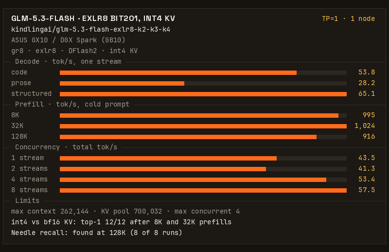
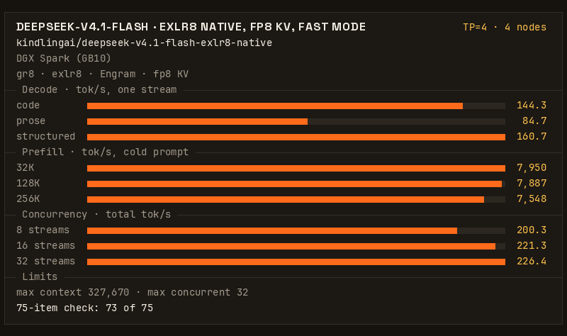

# gr8: a CUDA inference engine for DGX Spark

Need help? Join us on Discord: https://discord.gg/8EAvYPV2rE

gr8 serves GLM-5.3, GLM-5.3-Flash and DeepSeek-V4.1-Flash on one to six DGX Spark (GB10) boxes (the count depends on
the model, see below). The model is split across all the boxes (tensor parallel, TP). gr8 is written from scratch in
CUDA and uses no vLLM, PyTorch or NCCL at serve time. Each box runs one engine process (`g6m4`) and is one rank. The
ranks talk over RoCE v2 through gr8's own RDMA code, and an OpenAI-compatible API runs on the first box. *Beta
release. If you run it, please tell us what breaks: issues and PRs are welcome.*

## Recipes

Each recipe is one Docker image, set up for one model on a fixed number of boxes.

### GLM-5.3-Flash on 1 Spark

[](https://github.com/kindlingai/glm-5.3-flash-exlr8-1x-spark)

54.3 tok/s for one request writing code · 1,214 tok/s prefill on an 8K prompt · 4 requests at once from a 700,032-token KV
pool · one `docker run`

**[Recipe](https://github.com/kindlingai/glm-5.3-flash-exlr8-1x-spark)** · [Model page](docs/FLASH.md)

### GLM-5.3-Flash on 2 Sparks

71.1 tok/s for one request writing code · 1,698 tok/s prefill on an 8K prompt · 4 requests at once · first run, work in
progress

**[Recipe](https://github.com/kindlingai/glm-5.3-flash-exlr8-2x-spark)** · [Model page](docs/FLASH.md)

### GLM-5.3 on 4 or 6 Sparks

52.1 tok/s for one request writing code on four boxes, 57.4 on six (one of the six clock-capped) · up to 8 requests at
once · recipes coming soon. Until then, start it on three to six boxes with Docker Compose, from the
[Models and install](#models-and-install) table.

[Model page](docs/GLM-5.3.md)

### DeepSeek-V4.1-Flash on 4 Sparks

[](https://github.com/kindlingai/deepseek-v4.1-flash-exlr8-4x-spark)

142.9 tok/s for one request writing code · 3,655 tok/s prefill on an 8K prompt · 32 requests at once (the recipe's
setting) · fast mode by default (`TUNE=speed`), so the output is not identical to the exact model's; `TUNE=quality`
gives the exact model's output · the recipe's image is not built yet

**[Recipe](https://github.com/kindlingai/deepseek-v4.1-flash-exlr8-4x-spark)** · [Model page](docs/DEEPSEEK.md)

<sub>Each card is drawn by `bench/gif.py card` from the recipe's `kindling.json` ([docs/cards/make.sh](docs/cards/make.sh)
redraws them). The model pages give each benchmark and its date.</sub>

## What gr8 does today

- **Three models, one to six boxes.** GLM-5.3 on three to six boxes, GLM-5.3-Flash on one to four, DeepSeek-V4.1-Flash
  on four ([Models and install](#models-and-install)).
- **Boots from its own cache.** On GLM-5.3 each box fetches only its own part of the release, once. After that, GLM-5.3 boots in
  about 40 s and GLM-5.3-Flash on one box in 45 s.
- **Many chats at once, and long ones.** GLM-5.3 decodes 8 requests at once from a KV pool of up to 614,400 tokens
  (TP=6). GLM-5.3-Flash on one box decodes 4 at once from a 700,032-token pool. DeepSeek-V4.1-Flash runs 5 chats at
  once by default and up to 16, and with `CAP=1048576` one request can hold up to 1,048,566 tokens, prompt and reply
  ([docs/FIRST-BOOT.md](docs/FIRST-BOOT.md#2-deepseek-v41-flash-ds41-how-many-chats-and-how-long)).
- **Prefix reuse and KV below the pool.** A request that continues a conversation prefills only its new part: a
  continued 20K-token conversation takes 7.1 s instead of 17.3 s (GLM-5.3, TP=4). On GLM-5.3, evicted prefixes can go
  to an SSD or to a KV node with spare memory, over RDMA. From a KV node, the next turn of a 445,855-token prompt
  answered in 11.4 s (experimental, [Remote KV](docs/GLM-5.3.md#remote-kv)). GLM-5.3-Flash can keep its session
  checkpoints in the same kinds of store
  ([experimental](docs/FLASH.md#session-checkpoints-gr8_glm53f_cachealigned-experimental)). DeepSeek-V4.1-Flash has no
  store below the device.
- **Image input.** DeepSeek-V4.1-Flash takes images in chat requests (opt-in, `GR8_DS41_VISION=1`,
  [docs/DS41-VISION.md](docs/DS41-VISION.md)).
- **A Docker image.** `ghcr.io/kindlingai/gr8` has the engine for every TP width and all three models, so GLM-5.3 on
  three to six boxes needs no build ([Docker Compose](docs/DEPLOY.md#docker-compose)). The one-box and two-box recipes publish their
  own images.

## Models and install

| model | boxes | start here | download | weights on Hugging Face |
|---|---|---|---|---|
| [GLM-5.3-Flash](docs/FLASH.md) | 1 | [glm-5.3-flash-exlr8-1x-spark](https://github.com/kindlingai/glm-5.3-flash-exlr8-1x-spark): one `docker run` | 87 GB | [kindlingai/glm-5.3-flash-exlr8-k2-k3-k4](https://huggingface.co/kindlingai/glm-5.3-flash-exlr8-k2-k3-k4) |
| GLM-5.3-Flash | 2 | [glm-5.3-flash-exlr8-2x-spark](https://github.com/kindlingai/glm-5.3-flash-exlr8-2x-spark): the same image on both boxes | about 86 GB a box | |
| GLM-5.3-Flash | 3 or 4 | [docs/FLASH.md](docs/FLASH.md) | see the page | |
| [GLM-5.3](docs/GLM-5.3.md) | 3 to 6 | Docker Compose (below), or [docs/DEPLOY.md](docs/DEPLOY.md) for bare metal and Kubernetes | about 90 GB a box with 4 boxes (TP=4) | [kindlingai/glm-5.3-exlr8-k2-k3-k4](https://huggingface.co/kindlingai/glm-5.3-exlr8-k2-k3-k4) |
| [DeepSeek-V4.1-Flash](docs/DEEPSEEK.md) | 4 | [deepseek-v4.1-flash-exlr8-4x-spark](https://github.com/kindlingai/deepseek-v4.1-flash-exlr8-4x-spark), or [docs/DEEPSEEK-BOOT.md](docs/DEEPSEEK-BOOT.md) on bare metal | 510.6 GB a box, fetched before the first boot | [kindlingai/deepseek-v4.1-flash-exlr8-native](https://huggingface.co/kindlingai/deepseek-v4.1-flash-exlr8-native) |

Each model's page has its results, how to start it and its known issues.

**Three to six boxes** (GLM-5.3), with Docker Compose. On every box:

```bash
mkdir -p ~/gr8 && cd ~/gr8
curl -fsSLO https://raw.githubusercontent.com/kindlingai/gr8/main/docker/compose.yaml
curl -fsSL https://raw.githubusercontent.com/kindlingai/gr8/main/docker/.env.example -o .env
nano .env                          # GR8_MODEL, MODEL, PEERS and (glm53 at TP=4) DRAFTER: the same file on every box
docker compose up -d
```

Then `docker compose exec gr8 /opt/gr8/gr8 glm53 smoke` on the head. [docs/DEPLOY.md](docs/DEPLOY.md) explains each
setting, and has bare metal and Kubernetes. An agent that starts gr8 for someone asks them the questions in
[docs/FIRST-BOOT.md](docs/FIRST-BOOT.md) first.

**DeepSeek-V4.1-Flash** on bare metal: [docs/DEEPSEEK-BOOT.md](docs/DEEPSEEK-BOOT.md) is its boot in order, from the
four boxes to a passing `./gr8 ds41 smoke`.

### With model-loader

[model-loader](https://github.com/kindlingai/model-loader) can fetch the weights instead of gr8: the boxes copy the
pieces between them over the LAN, from one Hugging Face fetch or a NAS. Each surface takes it with one more file or
value: [docs/DEPLOY.md](docs/DEPLOY.md#with-model-loader).

## What you need

Each model's page gives its box count. [docs/GLM-5.3.md](docs/GLM-5.3.md#what-you-need) and
[docs/DEEPSEEK-BOOT.md](docs/DEEPSEEK-BOOT.md#1-what-you-need) add memory and disk.

- DGX Spark or other GB10 boxes (sm_121a, 128 GB unified memory), one rank per box, with nothing else holding much
  memory.
- One box needs no fabric and no LAN: at TP=1 the launcher skips the RDMA checks
  ([docs/FLASH.md](docs/FLASH.md#one-box-tp1)).
- Two or more boxes need a RoCE v2 fabric with two rails: each box's ConnectX-7 has one address on each PCIe root. Two
  boxes need no switch: one 200G cable joins their ConnectX ports, as in the
  [two-box recipe](https://github.com/kindlingai/glm-5.3-flash-exlr8-2x-spark#clustering). For three or more we use one
  200G switch. At TP=3 or 4, `--shape ring` runs without one: each box's f0 port is cabled to the next box's f1 port, and
  at TP=4 the diagonal's writes are relayed by the box between, through a 32 MB ring per fabric (about 0.25 GB pinned
  per rank). It costs about 10% of single-stream decode (4-5% at 4 streams). memlock must be unlimited. With mentat
  (`--mentat localhost --tp 3 --shape ring`, mentatd 0.24.0 or later on every box), the cabling can be any ring: the
  boxes claim a ring from mentat and take their rank order and RDMA devices from its one answer, so a scheduler such
  as a Kubernetes LeaderWorkerSet can place them in any order. Tag both addresses of each ConnectX port `rdma` in
  mentat (`MENTAT_ANNOUNCE_IFACES`).
- Two or more boxes also need a LAN between them with TCP ports 7340 and 7341 open. The boxes need no ssh between
  them: the head engine passes each request to the other ranks over its control links.
- Proactive memory compaction off on every box ([docs/DEPLOY.md](docs/DEPLOY.md#before-you-start) has the commands).
  A rank fills the box to about 2 GB under its limit, and at that level the kernel's background compaction moves pages
  under the engine in bursts that delay every collective.
- To build: CUDA 13 (`nvcc` with `sm_121a`), g++ with C++20, CMake, clang and libclang-dev (the front end builds XGrammar), rdma-core / libibverbs-dev, Rust through
  [rustup](https://rustup.rs) (the front end needs Rust 1.85 or later; Ubuntu 24.04's `cargo` package is 1.75), and
  Python 3 with venv. The stock DGX OS (Ubuntu 24.04) has all of them except Rust. Or, in place of all of these, Docker
  with the NVIDIA container toolkit (DGX OS has both): see [Docker Compose](docs/DEPLOY.md#docker-compose).

## Running it

Every box runs the same `./gr8 <model> up`, where the model is `glm53`, `glm53f` or `ds41`
([docs/DEPLOY.md](docs/DEPLOY.md)). The first address in `--peers` is the
head: it runs the API on port 8100. Before any engine starts, the boxes compare their options, model and engine build,
and if one box differs, every box stops and prints the difference. Without `--peers`, the boxes find each other through
a local mentat daemon (`--mentat localhost`, the default).

| command | what it does |
|---|---|
| `up [OPTIONS]` | start this box's supervisor and follow it until the cluster serves |
| `down`, `restart` | stop every box, or stop and boot again (in Docker: `down`, then `up -d` on every box) |
| `status` | every box's state, engine and free memory, and the head's front end and `/health` |
| `health` | this box alone, in one line: exit 0 when it serves (on the head, also its API's `/health`), else 1. The compose healthcheck, and a Kubernetes `exec` readiness probe on any rank |
| `logs [rank\|shim\|front\|supervisor] [-f]` | a log from any box |
| `prepare [OPTIONS]` | fill `--model-cache` with this box's part, without booting |
| `check`, `show-config` | what would stop this box's boot; every option and where it came from |
| `smoke`, `bench` | the smoke test, and prefill and decode benchmarks, against the API on this box (run them on the head) |
| `build` | the engine and the Rust front end, into `bin/` |

Options come from the command line, then a config file (`@FILE`, else `./cluster.env`; see
[config/cluster.env.example](config/cluster.env.example)), then the environment. With the options in `cluster.env`,
`./gr8 glm53 up` alone is enough. `./gr8 knobs` lists every option, and [KNOBS.md](KNOBS.md) says how they combine.

When a rank's engine exits, the head stops every box: `status` names the rank and shows its last log line, and the
supervisor log names the line that says why. Logs are in `out/` on each box (`supervisor.log`, `g6m4.r<r>.err`, and
`shim.log` and `front.log` on the head). Each boot moves the previous engine logs to `out/prev1`, and keeps the three
boots before it (`prev1` is the newest), so a restart does not overwrite the boot you want to look at.

## Troubleshooting

- "handshake refused": every box prints the field that differs and each box's value. It is an option, the model (a
  different commit or variant), the engine build, a box whose checks failed, or a box that does not answer on a rail.
- The boot stops with "GiB left after the weights and part of a KV pool": lower `--cap`, or use a smaller `--variant`.
- A box waits for the others: with mentat, check that every box's daemon sees the rest (`mentatd status`); with
  `--peers`, the workers wait for the head.
- Each rank checks its weights at boot: the GPU sums what it holds and compares with the bytes the loader read. A
  difference stops the boot with exit 3 and names the rank and the chunk ("g6: weight check: ..."). Once serving,
  `curl localhost:8100/health?deep` on the head checks every rank again ([frontend/README.md](frontend/README.md)).
  `EXTRA_ENV=GR8_WEIGHT_CHECK=0` turns both off.
- GLM-5.3 troubleshooting is in [docs/GLM-5.3.md](docs/GLM-5.3.md#troubleshooting). Open bugs for every model are in
  [KNOWN-ISSUES.md](KNOWN-ISSUES.md).

## API and ports

The head serves the OpenAI API on port 8100. [frontend/README.md](frontend/README.md) has the full API.

| port | what | where |
|---|---|---|
| 8100 | the OpenAI-compatible API (`/v1/chat/completions`, `/v1/completions`, `/v1/models`, `/health`) | head |
| 7340 | the supervisors: the handshake before boot, then status, logs and down | every box |
| 7341 | the multi-session control channel between the ranks | head |
| 18600-18659 | fabric bootstrap and the per-collective regions | head |

## Layout

| path | what |
|---|---|
| `gr8` | the entry point: `./gr8 <model> <command>` |
| `tools/launch/` | the per-box supervisor behind `up`: options, the model and its cache, the handshake, mentat |
| `engine/runtime/` | `g6m4.cu` (one rank), `m4sim.cu` (one GPU simulating every rank), the step, prefill and the multi-session scheduler (`s2/`) |
| `engine/kernels/` | experts and dense trellis matrices, GEMV/GEMM, router, norms, sampling |
| `engine/attn/` | MLA decode and prefill attention and the sparse indexer |
| `engine/comms/` | the RoCE v2 verbs fabric: collectives, bulk proxy, context-parallel layout |
| `engine/loader-rs/` | the Rust loader: plans each rank's image from the release, fetches from Hugging Face, converts the drafter |
| `engine/kvman-rs/` | the Rust S2 page allocator: every rank's KV pages, live and retained runs, prefix-reuse matches |
| `frontend/` | the HTTP front end (`g6front-rs`) and the shim that drives the ranks |
| `scripts/` | build, tests and `engine_args.sh` (the engine command line) |
| `tools/convert/` | the readers, writers and test fixtures behind the exlr8 release |
| `smoketest/`, `bench/` | the smoke test, benchmarks and the quality gate |
| `docs/` | one page per model, deploy and boot guides, engine settings, the prefill attention design, the model-specific parts |
| [KNOBS.md](KNOBS.md), [KNOWN-ISSUES.md](KNOWN-ISSUES.md), [PROTOCOL.md](PROTOCOL.md), [AGENTS.md](AGENTS.md) | how the options combine (`./gr8 knobs` lists them); open bugs; the front end to engine protocol; how to build, test and land a change |

gr8 is not a general engine: it is written for the shapes of the three models above.
[docs/MODEL-SPECIFIC.md](docs/MODEL-SPECIFIC.md) lists every place GLM 5.3 is built in, and what would carry over to
another model.

## Credits

KindlingAI is:

- [@adapt-ai-systems](https://github.com/adapt-ai-systems)
  - Prefill optimization, TP=6 S2 serving and context-budget improvements
    ([#7](https://github.com/kindlingai/gr8/pull/7), [#9](https://github.com/kindlingai/gr8/pull/9),
    [#27](https://github.com/kindlingai/gr8/pull/27), [#29](https://github.com/kindlingai/gr8/pull/29)).
  - Earlier engine, TP=3 conversion and gate foundations preserved in the Git history
    ([range fetching and manifests](https://github.com/kindlingai/gr8/commit/2d88926cb08bec602ba6382ccf10d90e1a735841),
    [gate harness](https://github.com/kindlingai/gr8/commit/3d6116f084b86aa96d4be47b253e223ef7a5dcea)).
  - DeepSeek-V4.1-Flash on four boxes: the `ds41` tuning knobs and served defaults
    ([#327](https://github.com/kindlingai/gr8/pull/327)-[#333](https://github.com/kindlingai/gr8/pull/333),
    [#335](https://github.com/kindlingai/gr8/pull/335)-[#338](https://github.com/kindlingai/gr8/pull/338)),
    and this boot guide.
- [@coffee-the-dev](https://github.com/coffee-the-dev)
- [@mmastrac](https://github.com/mmastrac)

The following contributions are greatly appreciated. If your name is missing, please file a PR: we want to ensure your work is recognized!

Thanks to:

- [@turboderp](https://github.com/turboderp)
  - EXL3 ideas, research and trellis quantization through [exllamav3](https://github.com/turboderp-org/exllamav3).
- [@OsakaTX](https://github.com/OsakaTX)
  - Launcher and container reliability, shell quoting and process handling
    ([#8](https://github.com/kindlingai/gr8/pull/8), [#16](https://github.com/kindlingai/gr8/pull/16),
    [#17](https://github.com/kindlingai/gr8/pull/17), [#21](https://github.com/kindlingai/gr8/pull/21)).
  - Setup documentation, input validation and HTTP defaults/connection limits
    ([#15](https://github.com/kindlingai/gr8/pull/15), [#18](https://github.com/kindlingai/gr8/pull/18),
    [#20](https://github.com/kindlingai/gr8/pull/20)).
- [@jakejharris](https://github.com/jakejharris)
  - Per-request activation steering, Ablit integration, profile tooling and qualification reports
    ([#45](https://github.com/kindlingai/gr8/pull/45) and its extracted steering PRs).
  - Ring relay backpressure and regression tests
    ([#58](https://github.com/kindlingai/gr8/pull/58), [#59](https://github.com/kindlingai/gr8/pull/59)).
- [@knapcio](https://github.com/knapcio)
  - Performance experiments and proposals for speculative decoding and INT4 draft weights
    ([#83](https://github.com/kindlingai/gr8/pull/83), [#85](https://github.com/kindlingai/gr8/pull/85),
    [#88](https://github.com/kindlingai/gr8/pull/88), [#89](https://github.com/kindlingai/gr8/pull/89)).
  - Fabric MTU negotiation, distributed GEMVs, MoE overlap, attention kernels and decode profiling proposals
    ([#82](https://github.com/kindlingai/gr8/pull/82), [#84](https://github.com/kindlingai/gr8/pull/84),
    [#86](https://github.com/kindlingai/gr8/pull/86), [#87](https://github.com/kindlingai/gr8/pull/87),
    [#90](https://github.com/kindlingai/gr8/pull/90)).
  - Shared-scope steering in S2 batched decode (the MoE shared-expert finalize of shared steps,
    [#209](https://github.com/kindlingai/gr8/pull/209)).
- [@eqvse](https://github.com/eqvse) and [@cl83](https://github.com/cl83)
  - TP=3/TP=4 ring fabric and relay support ([#4](https://github.com/kindlingai/gr8/pull/4)).
- [@chuck-ads](https://github.com/chuck-ads)
  - TP=4/TP=6 KL reference baselines and prompt-set benchmarking
    ([TP=4 baseline](https://github.com/kindlingai/gr8/commit/b671f958852bab1a139e9de5cd5904b368b3c5b1),
    [TP=6 baseline](https://github.com/kindlingai/gr8/commit/54c9161abaae5b317e74f26fc3bf9cf207535cf2),
    [prompt sets](https://github.com/kindlingai/gr8/commit/d9543184d9332996ab828bcffefcad892ed757e4)).
- [@spectra-the-bot](https://github.com/spectra-the-bot)
  - Host-memory reclamation and canonical session KV export/import
    ([#60](https://github.com/kindlingai/gr8/pull/60), [#65](https://github.com/kindlingai/gr8/pull/65)).
- [@unsaltedbutter-ai](https://github.com/unsaltedbutter-ai)
  - API compatibility and structured-output proposals ([#71](https://github.com/kindlingai/gr8/pull/71)).
- [@msuiche](https://github.com/msuiche)
  - Native GLP (GGUF) steering input: [weightless](https://weightle.ss/) GLP vectors load as steering
    profiles through the schema-v1 validation path ([GLP spec](https://github.com/msuiche/weightless/blob/main/docs/spec/GLP.md)).
- [@alexellis](https://github.com/alexellis)
  - [RigMark](https://github.com/alexellis/rigmark), used for decode and concurrency benchmarking.
- [@0xr3ngar](https://github.com/0xr3ngar)
  - Usage cache reporting for the glm dialect: the launcher now passes
    `--enable-prompt-tokens-details` to the front end, so
    `usage.prompt_tokens_details.cached_tokens` reaches clients on glm clusters.

### Upstream projects and research

- [exllamav3](https://github.com/turboderp-org/exllamav3) by [@turboderp](https://github.com/turboderp) and its contributors: the EXL3 format and its
  trellis quantizer, a streamlined variant of Cornell RelaxML's [QTIP](https://github.com/Cornell-RelaxML/qtip). This
  engine would not exist without their quantization work. The trellis decoders here were written from the EXL3 format,
  and the exlr8 weights were encoded with exllamav3's quantizer.
- [davidsyoung/GLM-5.3-EXL3-TR3-3.25bpw](https://huggingface.co/davidsyoung/GLM-5.3-EXL3-TR3-3.25bpw), whose
  per-expert bit distribution `home` keeps expert for expert.
- [RigMark](https://github.com/alexellis/rigmark) by [@alexellis](https://github.com/alexellis), for decode and concurrency benchmarking.
- [weightless](https://github.com/msuiche/weightless) by [@msuiche](https://github.com/msuiche): the GLP
  vector format ([spec](https://github.com/msuiche/weightless/blob/main/docs/spec/GLP.md)) and its
  reader-conformance contract, which the native steering input implements.
- The tool-call cases in `frontend/g6front-rs/src/parser.rs` are ported from vLLM's GLM tool-parser tests (Apache-2.0).

Credits are also maintained in [CREDITS.md](CREDITS.md).

## License

MIT, see [LICENSE](LICENSE). The weights and steering profiles are not part of this repository and carry their own
licenses (GLM 5.3's license, each release's model card and notice, and the DFlash2 drafter's CC BY-NC-ND 4.0).
