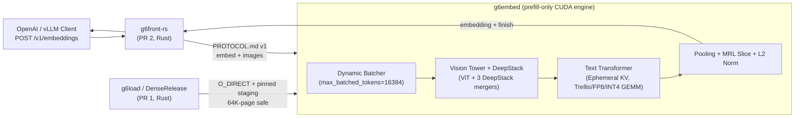

# RFC: Native CUDA Dense Embedding Runner in `gr8` (PR 3)

- **Status**: Draft for maintainer design sign-off
- **Target Models**: `Qwen/Qwen3-VL-Embedding-{2B,8B}` (`qwen3_vl` exlr8-k4) and `google/embeddinggemma-2` (`embedding_gemma2` exlr8-k4)
- **Target Hardware**: Single DGX Spark / GB10 (`TP=1`, 128 GB unified memory, ARM64 64K-page kernel, 2200 MHz GPU cap); optional `TP=2` follow-on
- **Prerequisites (already landed on `feat/dense-embeddings`)**:
  - **PR 1** (`feat(loader): support multi-group exlr8 dense profiles`): `engine/loader-rs/src/exlr8.rs` discovers, verifies XXH64 checksums, and decodes `exlr8-dense-<group>-LLL.safetensors` + `exlr8-vocab.safetensors` for `embedding_gemma2` and `qwen3_vl` (including 8B non-128 `FP8_ROW` `side=OUT` and copied 2D `BF16` `pos_embed`).
  - **PR 2** (`feat(frontend,protocol): add /v1/embeddings endpoint and embed wire frame`): `PROTOCOL.md` v1 capability `"embeddings": true`, `embed`/`embedding` frames, `frontend/g6front-rs` `/v1/embeddings` handler, and `frontend/pseudo-engine` mock support.

---

## 1. Motivation & Goals

A typical BF16 vLLM deployment of `Qwen3-VL-Embedding-2B` on GB10 with a 4 GiB KV-cache floor (`--kv-cache-memory-bytes 4294967296 --gpu-memory-utilization 0.09 --enforce-eager`) consumes ~11.5 GiB total footprint for a 4.25 GB weight set. Moving to `exlr8-k4` weights cuts weight bytes ~3× (2B: ~1.5 GB; 8B: ~5.5 GB), and an **embedding-only runner in `gr8`** eliminates the autoregressive KV cache, decode scheduler, and Python/PyTorch overhead entirely.

### Goals
1. Serve `kindlingai/Qwen3-VL-Embedding-2B-exlr8-k4`, `kindlingai/Qwen3-VL-Embedding-8B-exlr8-k4`, and `kindlingai/embeddinggemma-2-exlr8-k4` natively via `g6front-rs` `/v1/embeddings` + `PROTOCOL.md` v1 (`embed` / `embedding`).
2. Keep total GPU+host footprint under **~2.8 GiB** for 2B-K4 and **~7.0 GiB** for 8B-K4 (vs ~11.5 GiB for 2B BF16 vLLM).
3. Achieve end-to-end embedding cosine similarity **`>= 0.9999`** vs the reference `exlr8.load_dense_model` + `transformers` forward on identical quantized weights (both full-dim and MRL truncated dims, text and multimodal).
4. Zero regression on existing generative engines (`glm53`, `glm53f`, `ds41`, `qw38`, `ink2`) and zero changes to their binary/memory paths.

### Non-Goals (for PR 3 v1)
- Video inputs (production vLLM pins `--limit-mm-per-prompt '{"image": 4, "video": 0}'`).
- Multi-node `TP >= 2` for 2B/8B embeddings (both models fit comfortably on one GB10 rank with >120 GiB headroom; `TP=1` eliminates all RDMA/all-reduce latency).
- Audio inputs for EG2 in Milestone 1 (text + vision first; audio tower is a clean additive Milestone 4).

---

## 2. Target Model Architectures & Weight Formats

| Property | Qwen3-VL-Embedding-2B | Qwen3-VL-Embedding-8B | EmbeddingGemma 2 |
|---|---:|---:|---:|
| **`model_profile`** | `qwen3_vl` | `qwen3_vl` | `embedding_gemma2` |
| **Text layers** | 28 (`H=2048, I=6144`, 16Q/8KV, `hd=128`) | 36 (`H=4096, I=12288`, 32Q/8KV, `hd=128`) | 24 (Gemma2 text + PLE) |
| **Text attention** | Causal GQA + QK-norm + interleaved 3D M-RoPE `[24,20,20]`, `theta=5e6` | Same | Bidirectional sliding/full + RoPE |
| **Vision tower** | 24 blocks (`H_v=1024, I_v=4096`, 16H, `patch=16, merge=2, pos=2304`) | 27 blocks (`H_v=1152, I_v=4304`, 16H, `patch=16, merge=2, pos=2304`) | 16 blocks (`vision_tower`) |
| **DeepStack taps** | ViT `[5,11,17]` -> LLM `[0,1,2]` (`use_postshuffle_norm=True`) | ViT `[8,16,24]` -> LLM `[0,1,2]` (`use_postshuffle_norm=True`) | None |
| **Audio tower** | None | None | 12 blocks (`audio_tower`) |
| **Linear quant formats** | Trellis K4 mcg (+int4 g32 exc) | Trellis K4 mcg (+int4 g32 exc) + **`FP8_ROW` (`side=OUT`)** on ViT `mlp.linear_fc1/2` (`4304`) | Trellis K4 mcg (+int4 g32 exc) |
| **Special 2D tensors** | `visual.pos_embed` copied `BF16`; `embed_tokens` `FP8_ROW` | Same | `embed_tokens` `FP8_ROW` |
| **Non-2D tensors** | Norms, ViT biases, 5D `patch_embed.proj` (`BF16`) | Same | Norms, scalars, convs (`BF16`) |
| **Pooling & MRL** | Last non-pad token + L2 norm, MRL `[64..2048]` | Last non-pad token + L2 norm, MRL `[64..4096]` | Masked mean pool + `embedding_projection` + L2 norm |

---

## 3. System Architecture

### 3.1 Binary & Host-Core Integration
Following `docs/ADDING-A-MODEL.md` and `docs/HOST-CORE.md`:
- Introduce a dedicated `TP=1` embedding engine target **`g6embed`** (compiled via `MODEL=embed` in `scripts/build.sh`), sharing `engine/loader-rs`, `engine/kernels/dtr.cuh` (dense trellis), `engine/kernels/` FP8/INT4 GEMMs, and `PROTOCOL.md` Unix socket framing directly (no S2 decode/KV-page-table/RDMA machinery needed, because embedding requests have **zero decode steps** and **zero persistent KV state**).
- Direct Unix socket server inside `g6embed` (or thin C++/Rust socket loop speaking `PROTOCOL.md` v1 directly):
  - Sends `hello`: `{"type": "hello", "version": 1, "model": ..., "max_model_len": 16384, "vocab_size": 151936, "eos_ids": [151645], "max_logprobs": 0, "embeddings": true, "embedding_dim": 2048|4096, "matryoshka": true, "vision": true}`.
  - Reads `embed` / `cancel` / `metrics` frames on an ingress thread, packs ready requests into token-budgeted batches (`max_batched_tokens`, default `16384`), executes one forward pass on the CUDA stream, and emits `embedding` + `finish` frames immediately.
- Register `qwen3vl-emb-2b`, `qwen3vl-emb-8b`, and `eg2` entries in `tools/launch/models.py` (`tp=(1,)`, `fabric=False`, `dialect='qwen'` / `'hf'`) only once CUDA parity tests pass.

### 3.2 Multi-Group Weight Loading (Building on PR 1)
`engine/loader-rs` already provides `DenseRelease::discover`, `Matrix::verify_checksums`, and `decode_par` for all formats (`TRELLIS`, `INT4`, `FP8_ROW`, `BF16`, `FP32`). For `g6embed`, add a compact device-image planner (`engine/loader-rs/src/embed_plan.rs`):
1. **Hash & checksum verification**: Always verify `M.checksum` (XXH64) on boot unless `NOHASH=1` (matching `AGENTS.md`).
2. **Storage representation on GPU (GB10)**:
   - **Trellis K4 (`TRELLIS`)**:
     - Keep native packed `M.trellis` + `suh` + `svh` on device (~0.52 B/param) and run via `dtr.cuh` for small batches (`M < 16`).
     - Optional `GR8_EMBED_PF_MXFP8=1` (mirroring `GR8_QW38_PF_MXFP8`): dequantize/pack to ephemeral MXFP8 or tile-dequantize inside a fused Blackwell Tensor Core GEMM for large prefill batches (`M >= 16`) so high-concurrency embedding throughput saturates GB10 FP8 Tensor Cores without doubling resident weight VRAM. (Fallback knob `GR8_EMBED_DEQUANT_BF16=1` decodes weights to BF16 on load for exactness debugging and comparison.)
   - **INT4 g32 exceptions (`INT4`)**: Load `q4` + `s4` directly (re-laid to HF orientation when `side=IN`) and dispatch via existing `int4` GEMM kernel.
   - **FP8 per-row (`FP8_ROW`, `side=OUT`)**:
     - `embed_tokens` (`[151936, H]`): resident as `uint8 fp8` + `float32 scale[V]` (2B: 311 MB vs 622 MB BF16; 8B: 622 MB vs 1.24 GB BF16); fused token lookup kernel dequantizes only the active batch rows directly into BF16 activation buffer.
     - 8B ViT `mlp.linear_fc1` (`[4304, 1152]`) & `mlp.linear_fc2` (`[1152, 4304]`): resident as `uint8 fp8` + `float32 scale[out]`, executed with row-scaled FP8 GEMM (or cuBLASLt `FP8` / BF16 dequant-on-fly since 27 layers × 2 matrices = 268M params = 268 MB total).
   - **Copied BF16 (`BF16` & non-2D tensors)**: `model.visual.pos_embed` (`[2304, H_v]`), 5D `model.visual.patch_embed.proj.weight`, norms, and biases loaded verbatim into BF16 device buffers.
3. **64K-Page Kernel Safety**: All reads flow through `g6load`'s `pread` (`O_DIRECT` when aligned) into pinned host staging buffers (`cudaMemcpyAsync`), completely bypassing pageable mmap H2D stalls on ARM64 64K-page GB10 kernels.

### 3.3 Qwen3-VL Vision Tower & DeepStack Pipeline
`gr8` already implements a 27-layer BF16 ViT with `16×16` patches, `2×2` spatial merger, bilinear `48×48` `pos_embed`, and axial 2D RoPE in `qw38` (`GR8_QW38_VISION=1`, `docs/QWEN38.md`). Qwen3-VL-Embedding's vision stack is structurally almost identical, with three concrete deltas:

1. **Frontend Image Processor (`frontend/g6front-rs/src/vision.rs`)**:
   - Add `vision::Model::Qwen3Vl`:
     - `patch_size=16`, `merge_size=2` (`factor=32`), `temporal_patch_size=2`, `min_pixels=4096`, `max_pixels=1310720` (4..1280 merged tokens per image), `image_token_id=151655` (`<|image_pad|>`), `mean=[0.5, 0.5, 0.5]`, `std=[0.5, 0.5, 0.5]`.
     - Implements `Qwen2VLImageProcessor` `smart_resize` + Pillow BICUBIC (already implemented in `vision.rs`!), producing padded RGB spans in `embed.images`.
     - Add golden pixel-parity test against `transformers.AutoProcessor` (same pattern as `glm5v_pixels_match_the_processor`).
2. **Packed Variable-Length ViT Forward (`engine/embed/qwen3vl_vit.cu`)**:
   - Patch embed (`Conv3d [H_v, 3, 2, 16, 16]` as linear `[N_patches, 1536] -> [N_patches, H_v]` with bias) + bilinear interpolated `pos_embed` (`48×48` grid, `align_corners=False` — verify exact interpolation flags against `transformers==4.57.1` `Qwen3VLVisionModel.fast_pos_embed_interpolate`!).
   - 24 (2B) or 27 (8B) ViT blocks with `cu_seqlens` packed full (non-causal) FlashAttention over each image's patches, axial 2D RoPE, LayerNorm (with bias), GELU (`gelu_pytorch_tanh`).
   - Linears dispatch through the mixed-format dense GEMM (Trellis K4 for 2B all + 8B `attn.qkv`/`attn.proj`; `FP8_ROW` for 8B `mlp.linear_fc1/2`).
3. **DeepStack Feature Capture & Injection**:
   - At ViT blocks `deepstack_visual_indexes` (`[5, 11, 17]` for 2B; `[8, 16, 24]` for 8B), immediately run `deepstack_merger_list[k]` (`use_postshuffle_norm=True`: `2×2` spatial merge -> LayerNorm(`4*H_v`) -> `linear_fc1` -> GELU -> `linear_fc2`) and store `[N_img_tokens, H_text]` into staging buffer `ds_buf[k]`.
   - Main merger (`model.visual.merger`) produces `[N_img_tokens, H_text]` replacing `<|image_pad|>` token embeddings before LLM layer 0.
   - During text transformer forward, immediately after LLM layers `0, 1, 2`, run an in-place scatter-add kernel: `hidden[img_token_indices] += ds_buf[layer_idx]`.

### 3.4 Text Transformer, Interleaved M-RoPE & Pooling
1. **3D Interleaved M-RoPE (`mrope_section=[24, 20, 20]`, `rope_theta=5e6`)**:
   - Host computes `(t, h, w)` 3D position IDs per token from prompt token spans + image `(grid_t, grid_h, grid_w)` (identical to `Qwen3VLModel.get_rope_index`), uploaded once per batch (`3 * total_tokens * 4` bytes).
   - Reuse `qw38`'s interleaved 3D M-RoPE kernel parameterized by `mrope_section=[24,20,20]` and `head_dim=128` (full rotary over all 64 pairs, unlike `qw38`'s partial 32 pairs).
2. **Ephemeral-KV Packed Prefill Attention**:
   - Pack variable-length batch items back-to-back with `cu_seqlens` (zero wasted compute on pad tokens!).
   - Per layer, compute `Q/K/V`, apply per-head QK-norm (`RMSNorm(128, eps=1e-6)`), apply M-RoPE, run FlashAttention (`causal=true` for Qwen3-VL; `causal=false` / sliding window for EG2) directly over packed `cu_seqlens`, then `O_proj` and SwiGLU MLP.
   - K and V tensors live in a single shared layer scratch buffer (~32–64 MiB for `16384` tokens), reused across every layer -> **0 bytes of persistent KV cache**!
3. **Pooling + MRL + L2 Norm Kernel (`engine/embed/pool.cu`)**:
   - **Qwen3-VL (`last_token`)**: For each sequence `b` with packed range `[cu[b], cu[b+1])`, read `hidden[cu[b+1] - 1]` (already exact last non-pad token because packed inputs contain no pad tokens!), cast to FP32, slice `0..dim` (where `dim = req.dimensions.unwrap_or(H)`), compute `inv_norm = rsqrt(sum(x^2) + 1e-12)`, write normalized FP32 vector to pinned host buffer.
   - **EG2 (`mean_pool`)**: Average `hidden[cu[b]..cu[b+1]]` in FP32, multiply by `language_model.embedding_projection` (Trellis K4), slice `0..dim`, L2-normalize.

---

## 4. Projected Footprint & Performance on GB10

| Engine / Model | Weight VRAM | KV / Workspace | Total Footprint | Notes |
|---|---:|---:|---:|---|
| vLLM BF16 2B (reference baseline) | 4.26 GiB | 4.00 GiB KV + ~3.2 GiB runtime | **~11.5 GiB** | Standard vLLM pooling config with 4 GiB KV floor |
| Interim Python shim (2B-K4, dequant BF16) | 4.26 GiB | ~0.6 GiB activations + PyTorch | **~6.0–7.0 GiB** | Reference `exlr8.load_dense_model` path; no KV floor |
| **`gr8` `g6embed` (2B-K4 native)** | **~1.45 GiB** | **~0.65 GiB workspace (16K tok)** | **~2.5 GiB** | **~4.6× smaller than BF16 vLLM** |
| **`gr8` `g6embed` (8B-K4 native)** | **~5.45 GiB** | **~0.95 GiB workspace (16K tok)** | **~6.8 GiB** | **Still smaller than BF16 2B vLLM** |

*(Exact GB10 latency and memory numbers will be recorded under identical boot conditions in the PR 3 hardware gate before merge.)*

---

## 5. Implementation Plan & Effort Breakdown

| Milestone | Scope & Files | Est. Effort | Verification Gate |
|---|---|---:|---|
| **M1: Loader & Weight Binder** | `engine/loader-rs/src/embed_plan.rs`, `engine/embed/weights.h`, C-ABI binding for multi-group `DenseRelease` (Trellis K4, INT4, FP8_ROW, BF16, 5D conv) | 2–3 days | CPU + 1-GPU unit test: load synthetic + real 2B/8B release with `NOHASH=0`, verify every tensor matches `exlr8.load_dense_model` bit-for-bit |
| **M2: Text-Only Qwen3-VL + EG2 Runner** | `engine/embed/{main.cpp,qwen3vl_text.cu,eg2_text.cu,gemm_dispatch.cuh,pool.cu}`, `PROTOCOL.md` socket loop, packed `cu_seqlens` FlashAttention + QK-norm + 3D M-RoPE + pooling | 4–5 days | 1-GPU exactness test vs `exlr8.load_dense_model` + `transformers`: per-layer residual cos `>= 0.9999`, text embedding cos `>= 0.9999`, full 11-task text eval matches reference within `±0.0005` |
| **M3: Qwen3-VL Vision + DeepStack** | `frontend/g6front-rs/src/vision.rs` (`Model::Qwen3Vl`, `min_pixels=4096..1310720`), `engine/embed/qwen3vl_vit.cu` (24/27 blocks, `FP8_ROW` 4304 MLP, DeepStack `[5,11,17]`/`[8,16,24]` mergers + LLM `[0,1,2]` scatter-add) | 4–5 days | CPU pixel-parity test vs `AutoProcessor`; 1-GPU ViT + DeepStack parity test (cos `>= 0.9999` vs BF16-dequantized K4 reference on ViDoRe images); multimodal `/v1/embeddings` smoke |
| **M4: Packaging, Launcher & Hardware Gates** | `scripts/build.sh` (`embed` target), `tools/launch/models.py` (`qwen3vl-emb-2b`, `qwen3vl-emb-8b`, `eg2`), `Dockerfile` stage, `smoketest/embed.py`, `docs/EMBEDDINGS.md` | 2 days | `bash .github/ci/cpu-tests.sh` green; GB10 benchmark & footprint vs vLLM BF16 baseline + interim Python shim; 64K-page boot check; thermal soak |
| **M5 (Optional): EG2 Vision + Audio** | EG2 vision (`16` blocks) + audio (`12` conformer blocks) towers | 3–4 days | EG2 multimodal eval parity within `±0.001` |

**Total for Qwen3-VL-2B & 8B + EG2 text (M1–M4)**: ~**12–15 engineering days** (~2.5–3 weeks).

---

## 6. Key Risks & Mitigations

1. **Trellis K4 prefill throughput at batch `M >= 16`**:
   - *Risk*: Decode-oriented `dtr.cuh` kernels optimize for small `M` (1..8) and may underutilize GB10 Tensor Cores on 16K-token embedding batches.
   - *Mitigation*: Implement tile-on-the-fly Trellis->FP8/BF16 staging into shared memory (or optional `GR8_EMBED_PF_FP8_CACHE` if spare VRAM allows on 128 GB GB10 — caching FP8 weights takes only +2 GB for 2B / +8 GB for 8B while achieving full cuBLASLt FP8 Tensor Core throughput). Benchmark both modes in M2 and ship the faster default with a rollback knob.
2. **DeepStack & bilinear `pos_embed` numerical edge cases**:
   - *Risk*: Slight differences in `fast_pos_embed_interpolate` (`align_corners`, rounding) or `gelu_pytorch_tanh` cause drift on high-res DocLayNet/ViDoRe pages.
   - *Mitigation*: Capture golden intermediate tensors (`patch_embed`, `pos_embed` output, each DeepStack merger output, LLM layer 0/1/2 post-injection hidden states) from `transformers==4.57.1` in `engine/ref/embed/golden.py` and gate M3 on `cos >= 0.9999` at every stage.
3. **8B ViT `4304` non-128 GEMM alignment**:
   - *Risk*: Standard 128-aligned tile kernels fail on `4304 % 128 = 80`.
   - *Mitigation*: `4304` is divisible by `16` (`4304 = 269 * 16`), which satisfies cuBLASLt BF16/FP8 `16`-byte alignment cleanly with zero padding hacks.

---

## 7. Open Decisions for Sign-Off

1. **Kernel mode for `g6embed` linear projections**: Prefer **(A) fused on-the-fly Trellis K4 GEMM** (minimum VRAM: ~2.5 GiB / ~6.8 GiB) or **(B) on-load Trellis->FP8 decode cache** (~4.5 GiB / ~14.8 GiB, maximum cuBLASLt FP8 throughput, zero new Trellis prefill kernel work)? *Recommendation*: Ship **(B)** as M2 fast-path (`GR8_EMBED_WEIGHT_MODE=fp8`, cutting M2 effort by ~2 days) with **(A)** (`trellis`) as M2b/follow-on if VRAM pressure requires it.
2. **Scope of PR 3a vs PR 3b**: Confirm shipping **Qwen3-VL-Embedding-{2B,8B} (text + vision + DeepStack)** first in PR 3a, followed by **EG2 (text + vision + audio)** in PR 3b.
3. **Protocol vision transport for `/v1/embeddings`**: Confirm reusing `PROTOCOL.md`'s existing `images` span format (`pos`, `vit_h`, `vit_w`, `key`, `rgb`) inside `embed` frames so `g6front-rs` shares one image preprocessing pipeline across chat and embeddings.
